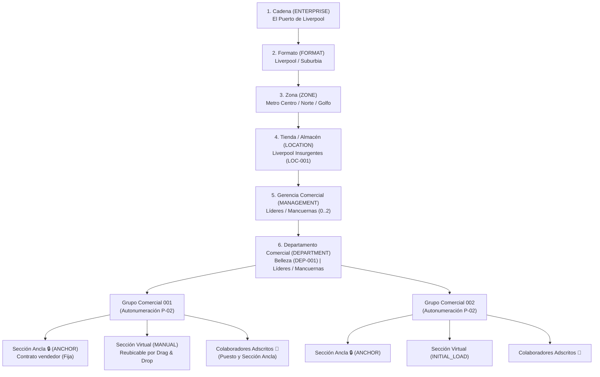
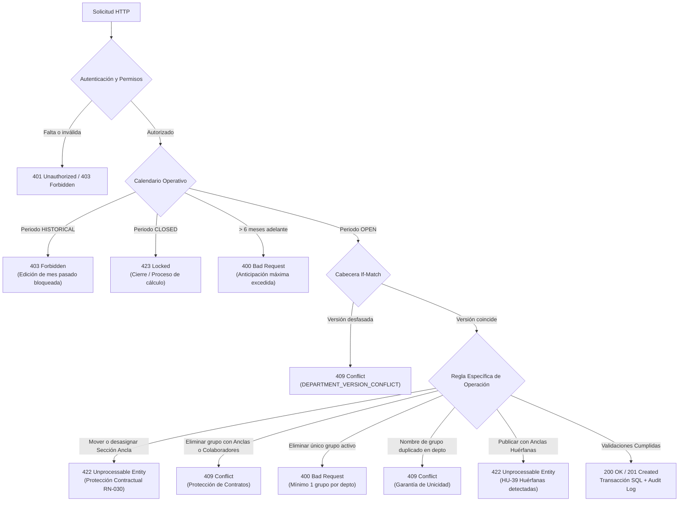

# Manual Técnico y de Arquitectura — ZDeptos API (Liverpool)
**Especificación:** MTI-II-ERF V2.1 / V3 & Casos de Uso v1.0 (Arturo Ocampo: CU-EST-001, CU-ADM-001 a CU-ADM-008, HU-13 a HU-53)  
**Módulo:** `feature-02-estructuras-tree` (Estructura de Árbol Comercial, Geografía, Grupos, Secciones, Calendario y Concurrencia)  
**Autor:** Antigravity AI & Equipo de Integración ZDeptos  
**Fecha:** Octubre 2026 — Versión 2.0  

---

## 1. Introducción y Contexto del Negocio

El sistema **ZDeptos** es una plataforma de misión crítica desarrollada para **Servicios Liverpool, S. A. de C. V.** para reemplazar la operativa de la antigua transacción **ZMPS_DEPTOS** de SAP ECC.

### ¿Por qué existe este backend?
Durante la modernización tecnológica a SAP SuccessFactors (Employee Central), se detectó que dicha plataforma era funcionalmente limitada para gestionar con la granularidad y flexibilidad que exige la operación en piso de venta (especialmente para la administración de secciones comerciales y jefaturas de tienda). 

Por ello, ZDeptos actúa como la **Fuente Única de Verdad** para la estructura operativa de tiendas, planes de venta, cuotas y comisiones de vendedores.

---

## 2. Los 6 Niveles de la Jerarquía Organizacional

La estructura comercial de Liverpool y Suburbia se organiza en 6 niveles estrictos:



### Definición de Cada Nivel:
1. **Cadena (ENTERPRISE):** Nivel corporativo raíz (El Puerto de Liverpool).
2. **Formato (FORMAT):** Tipo de negocio (Liverpool o Suburbia). Define plantillas comerciales.
3. **Zona (ZONE):** Agrupación geográfica para control y supervisión (ej. Metro Centro, Norte, Golfo).
4. **Tienda / Almacén (LOCATION):** Lugar físico donde opera el almacén. Es el nodo raíz de consulta del árbol de tienda.
5. **Gerencia Comercial (MANAGEMENT):** Supervisa múltiples departamentos comerciales dentro de una tienda específica. Admite co-liderazgo (Mancuernas: 0..2 líderes).
6. **Departamento Comercial (DEPARTMENT):** Unidad contable y operativa. **Es el nivel donde residen los Grupos Operativos y las Secciones.** Administra el token de versión para concurrencia optimista (`departmentVersion`) y la suma consolidada de secciones (`aggregatedSectionsCount`).
7. **Grupo Comercial (GROUP):** *"Departamento Agrupador"*. Contenedor anidado (ej. `Grupo 001`, `Grupo 002`) que consolida secciones y vendedores. Posee código inmutable y nombre descriptivo.
8. **Secciones (SECTION):** Nivel atómico donde se genera la venta y las comisiones. Se dividen en:
   - **Secciones Ancla (ANCHOR 🔒):** Adscritas contractualmente en Employee Central al vendedor. Inamovibles e indesasignables en tienda.
   - **Secciones Virtuales (INITIAL_LOAD / MANUAL / SCHEDULED):** Flexibles, reubicables entre grupos y desasignables al catálogo de disponibles.

---

## 3. Stack Tecnológico Explicado

| Tecnología | ¿Qué es? | Equivalente en otros ecosistemas | Función en ZDeptos |
| :--- | :--- | :--- | :--- |
| **Node.js 20+** | Entorno de ejecución de JavaScript en el servidor. | JVM (Java) / CLR (.NET) / Python Runtime | Ejecuta el backend. |
| **TypeScript 5** | Lenguaje fuertemente tipado. | C# / Java | Evita errores de tipo en tiempo de ejecución. |
| **NestJS 11** | Framework modular de Node.js en TypeScript. | Spring Boot (Java) / ASP.NET Core (C#) | Arquitectura limpia (Controladores, Servicios, Módulos, DTOs, Guards). |
| **TypeORM** | Mapeador objeto-relacional (ORM). | Hibernate (Java) / Entity Framework (.NET) | Mapeo de entidades y transacciones SQL atómicas. |
| **PostgreSQL 16 en Docker** | Base de datos relacional. | Oracle / SQL Server | Hospeda esquemas (`zd_core`, `zd_config`, `zd_ref`, `zd_plan`, `zd_audit`, `zd_security`). |
| **Swagger / OpenAPI 3.0** | Documentación interactiva autogenerada. | Swagger UI / Postman | Interfaz visual interactiva en `http://localhost:3000/api/docs`. |

---

## 4. Mapa de Archivos del Módulo (`feature-02-estructuras-tree`)

```text
feature-02-estructuras-tree/
├── openapi/
│   └── swagger-zdeptos-estructuras.json             # Especificación OpenAPI 3.0 exportada completa
├── zdeptos-estructuras.postman_collection.json      # Colección Postman v2 con los 13 endpoints y casos negativos
├── src/
│   ├── main.ts                                      # Configuración global, Swagger, Helmet, CORS, ValidationPipe
│   ├── app.module.ts                                # Módulo raíz que importa Geography, Structures y Audit
│   │
│   ├── modules/
│   │   ├── audit/                                   # Módulo de Auditoría (zd_audit.audit_event)
│   │   │   ├── audit.module.ts                      # Registro del módulo
│   │   │   ├── infrastructure/
│   │   │   │   ├── audit.repository.ts              # Inserción de eventos de auditoría
│   │   │   │   └── audit-event.entity.ts            # Entidad TypeORM de zd_audit.audit_event
│   │   │   └── domain/
│   │   │       ├── enums/                           # AuditAction, AuditEventCategory, AuditResult
│   │   │       └── audit.types.ts                   # Interfaces de payload de auditoría
│   │   │
│   │   ├── geography/                               # Selector en cascada de Zonas y Tiendas
│   │   │   ├── geography.controller.ts              # Endpoints GET /zones y GET /zones/:id/locations
│   │   │   ├── geography.service.ts                 # Consultas SQL a zd_core.structure_node
│   │   │   └── dto/geography-response.dto.ts        # DTOs de respuesta
│   │   │
│   │   └── structures/                              # MÓDULO PRINCIPAL DE ESTRUCTURA Y GRUPOS
│   │       ├── application/
│   │       │   └── structures.service.ts            # Toda la lógica transaccional, CTE, concurrencia y auditoría
│   │       ├── domain/entities/                     # Entidades mapeadas a PostgreSQL
│   │       │   ├── structure-node.entity.ts         # zd_core.structure_node
│   │       │   ├── commercial-group.entity.ts       # zd_core.commercial_group
│   │       │   ├── group-section-assignment.entity.ts # zd_core.group_section_assignment
│   │       │   ├── department-structure-state.entity.ts # zd_core.department_structure_state
│   │       │   ├── section-reference.entity.ts      # zd_ref.section_reference
│   │       │   └── operational-period.entity.ts     # zd_plan.operational_period
│   │       ├── presentation/
│   │       │   ├── structures.controller.ts         # 13 endpoints REST documentados con Swagger
│   │       │   └── dto/                             # Data Transfer Objects y esquemas OpenAPI
│   │       │       ├── structures.dto.ts            # CreateGroup, UpdateName, MoveSection, Assign, Publish
│   │       │       ├── tree-response.dto.ts         # TreeNode, Leader, Group, Section, Collaborator
│   │       │       ├── location-summary-response.dto.ts # Encabezado de tienda (HU-15)
│   │       │       ├── aggregated-section-response.dto.ts # Secciones consolidadas (ERF 4.1)
│   │       │       ├── available-section-response.dto.ts # Secciones disponibles (HU-27)
│   │       │       ├── mutation-response.dto.ts     # AssignResponse, UnassignResponse, Cutoff, Publish
│   │       │       └── error-response.dto.ts        # Esquemas de error 400, 401, 403, 404, 409, 422, 500
│   │       └── tests/
│   │           └── structures.controller.spec.ts    # Pruebas unitarias de los 13 endpoints (100% pasando)
```

---

## 5. Catálogo Completo de Endpoints Implementados

| # | Método | Ruta HTTP | Permiso Requerido | Caso de Uso | Descripción |
| :-: | :---: | :--- | :--- | :--- | :--- |
| **1** | `GET` | `/api/v1/health` | Público | SRE | Health check del sistema y base de datos. |
| **2** | `GET` | `/api/v1/geography/zones` | `STRUCTURE_VIEW` | UC-004 / HU-13 | Catálogo de Zonas comerciales (Metro Centro, Norte...). |
| **3** | `GET` | `/api/v1/geography/zones/:zoneId/locations` | `STRUCTURE_VIEW` | UC-004 / HU-13 | Tiendas físicas pertenecientes a la zona seleccionada. |
| **4** | `GET` | `/api/v1/structures/tree` | `STRUCTURE_VIEW` | CU-EST-001 / HU-14 | Árbol jerárquico de 6 niveles con soporte de `?period=YYYY-MM`. Si el periodo es histórico o cerrado devuelve `isReadOnly: true`. Expone mancuernas de líderes, colaboradores en grupos y total de secciones agregadas. |
| **5** | `GET` | `/api/v1/structures/locations/:locationId/summary` | `STRUCTURE_VIEW` | HU-15 / CU-ADM-001 | Resumen ejecutivo para el encabezado de tienda (código, nombre, zona, formato y total de departamentos). |
| **6** | `GET` | `/api/v1/structures/departments/:departmentId/groups` | `GROUP_VIEW` | HU-20 / CU-ADM-001 | Listado completo de grupos de un departamento con secciones y colaboradores adscritos. |
| **7** | `GET` | `/api/v1/structures/departments/:departmentId/aggregated-sections` | `SECTION_VIEW` | ERF 4.1 / CU-EST-001 | Consolidado total de secciones asignadas en todos los grupos del departamento. |
| **8** | `GET` | `/api/v1/structures/departments/:departmentId/available-sections` | `SECTION_VIEW` | HU-27, HU-28 | Catálogo de secciones activas disponibles no asignadas a ningún grupo. |
| **9** | `POST` | `/api/v1/structures/departments/:departmentId/groups` | `GROUP_CREATE` | CU-ADM-002 / P-02 | Crea un nuevo grupo operativo con autonumeración correlativa atómica (`FOR UPDATE`), unicidad de nombre en el departamento (`409 Conflict`), cabecera `If-Match` y auditoría (`GROUP_CREATED`). |
| **10** | `PUT` | `/api/v1/structures/groups/:groupId` | `GROUP_UPDATE` | CU-ADM-002 / HU-23 | Renombra el grupo operativo. Valida nombre no duplicado en el departamento, valida `If-Match` y registra auditoría (`GROUP_RENAMED`). |
| **11** | `DELETE` | `/api/v1/structures/groups/:groupId` | `GROUP_INACTIVATE` | CU-ADM-003 / HU-24 a HU-26 | Inactivación lógica del grupo. Valida mínimo 1 grupo (`400 Bad Request`), bloquea si tiene secciones ancla (`409 Conflict`) o colaboradores adscritos (`409 Conflict`), libera secciones virtuales y audita (`GROUP_DELETED`). |
| **12** | `PATCH` | `/api/v1/structures/departments/:departmentId/sections/move` | `SECTION_MOVE` | CU-ADM-004 / HU-32 a HU-37 | Drag & Drop de secciones virtuales entre grupos. Bloqueo estricto de Sección Ancla (`422 Unprocessable Entity`), concurrencia optimista (`If-Match`) e incremento de versión (`version + 1`). |
| **13** | `POST` | `/api/v1/structures/groups/:groupId/sections` | `SECTION_ASSIGN` | HU-29, HU-30 | Asigna una sección disponible a un grupo (`assignmentOrigin = 'MANUAL'`). Enforce de asignación única por tienda (`409 Conflict` si ya está ocupada), bump de versión y auditoría (`SECTION_ASSIGNED`). |
| **14** | `DELETE` | `/api/v1/structures/groups/:groupId/sections/:sectionId` | `SECTION_UNASSIGN` | HU-34, HU-37 | Desasigna una sección virtual de un grupo, regresándola a disponibles. Bloqueo de secciones ancla (`422 Unprocessable Entity`), bump de versión y auditoría (`SECTION_UNASSIGNED`). |
| **15** | `GET` | `/api/v1/structures/calendar/operational-cutoff` | `PLANNING_VIEW` | HU-52 / CU-ADM-005 | Consulta corte operativo y fechas límite del periodo consultado (`OPEN`, `HISTORICAL`, `CLOSED`), días restantes y bandera `isEditable`. |
| **16** | `POST` | `/api/v1/structures/departments/:departmentId/publish` | `PLANNING_PUBLISH` | HU-48 / CU-ADM-005 | Publica oficialmente la estructura departamental. Valida mínimo 1 grupo activo, valida que no haya secciones ancla huérfanas (HU-39: `422 Unprocessable Entity`), valida calendario, incrementa versión y audita (`DEPARTMENT_PUBLISHED`). |

---

## 6. Reglas de Negocio Implementadas y su Código HTTP



---

## 7. Instrucciones para Ejecutar y Probar

### 1. Pruebas Automatizadas (Jest)
Ejecutar la suite completa de pruebas:
```powershell
npm test
```
**Resultado actual:** 5 suites pasadas, **25 tests pasando exitosamente al 100%**.

### 2. Comprobación de Tipos (TypeScript)
```powershell
npm run typecheck
```
**Resultado actual:** 0 errores de compilación (`tsc --noEmit` exitoso).

### 3. Interfaz Visual Swagger UI
1. Abre tu navegador en: `http://localhost:3000/api/docs`
2. Haz clic en **Authorize** e introduce la llave local:
   ```text
   dev-api-key-zdeptos-2026
   ```
3. Ejecuta cualquiera de los endpoints directamente desde la consola interactiva.

### 4. Colección de Postman
Importa en Postman el archivo:
`zdeptos-integrado.postman_collection.json`
Incluye las 3 features completas (42 endpoints interactivos), variables de entorno preconfiguradas y casos de prueba tanto positivos como negativos.

---

## 8. Feature 03: Reportes, Historial de Auditoría y Cargas Masivas

### 8.1 Módulo de Reportes y Exportación CSV / TXT (`src/modules/reports`)
* **Catálogo de Columnas y Metadatos (`GET /api/v1/reports/metadata/columns`):**
  Organizado estrictamente en las 3 categorías funcionales (`CU-EST-002`, `CU-EST-003`, `HU-65`):
  1. `estructura`: `effectiveDate`, `zone`, `location`, `management`, `department`, `group`, `sectionId`, `sectionName`.
  2. `puestosPersonas`: `positionId`, `positionName`, `employeeId`, `employeeName`, `leaderName`, `isVacant`.
  3. `relaciones`: `anchorSection`, `managedSections`, `assignmentOrigin`, `status`.
* **Vista Previa de Reporte por Rol (`GET /api/v1/reports/role-based`):**
  * Validación de fechas (`startDate > endDate` -> `400 Bad Request`).
  * Validación de tramo de control (`FE-05`): Si el usuario solicita un `locationId` fuera de su alcance, rechaza con `403 Forbidden`.
  * Fotografías históricas sin sustitución silenciosa (`FA-03`, `FE-05`, `HU-060`): Si no existe fotografía para un periodo histórico cerrado en `zd_reporting.structure_snapshot`, responde `404 Not Found`. Para periodos futuros programados marca `isProjection: true` (`DEC-17`).
  * Proyección dinámica de columnas seleccionadas (`ColumnProjectionService`).
* **Vista Previa de Reporte General (`GET /api/v1/reports/general`):**
  * Exige permiso explícito `REPORTS_GLOBAL_VIEW`. Si el usuario solo tiene acceso a reportes por rol, rechaza con `403 Forbidden`.
* **Reportes de Compensaciones y Productividad (`GET /api/v1/reports/compensations`):**
  * Soporta variantes: `JEFES_CON_SECCION`, `GERENTES`, `JEFES`, `PRODUCTIVIDAD_10_COL`, `PRODUCTIVIDAD_FILA`, `OPERACIONES_ZDEPTOS` sin truncar datos en memoria (`DEC-15`).
* **Exportación CSV y TXT Pipe-Delimited (`GET /api/v1/reports/export/csv`, `GET /api/v1/reports/export/txt`):**
  * Valida permiso de descarga `REPORTS_EXPORT` / `REPORTS_DOWNLOAD_CSV` (`403 Forbidden` si solo tiene permiso de visualización).
  * Consistencia total con la vista previa.
  * Formato CSV: delimitado por comas, preservando ceros a la izquierda en códigos SAP (`="00123"`).
  * Formato TXT: delimitado por pipes (`|`) para interfaces downstream de SAP HCM / Nómina / Productividad.
  * Registra evento `REPORT_EXPORTED` en `zd_audit.audit_event`.

### 8.2 Módulo de Historial y Auditoría Inmutable (`src/modules/audit`)
* **Consultar Bitácora (`GET /api/v1/audit/logs`):**
  * Permiso `AUDIT_VIEW`.
  * Filtros por `startDate`, `endDate` (400 si fechas invertidas), `locationId` (restringido a alcance), `action`, `entityType`, `actorUserId`, `userSearch`.
  * Retorna los **9 campos mínimos obligatorios del ERF §7**: `id`, `modifiedAt`, `actorFullName`, `actorUserId`, `actorUsername`, `actorRole`, `action`, `entityType`/`entityDisplayName`, `effectiveDate`, `result`.
  * Mensaje informativo amigable si no hay coincidencias (`message: "No se encontraron movimientos para los filtros seleccionados."`).
* **Detalle de Movimiento (`GET /api/v1/audit/logs/:eventId`):**
  * Retorna campos obligatorios más `previousValue` (beforeValue), `newValue` (afterValue), `reason` y `source` (404 si no existe, 403 si fuera de alcance).
  * 100% inmutable y de solo lectura.

### 8.3 Módulo de Cargas Masivas Iniciales (`src/modules/batch-import`)
* **Especificación y Plantilla (`GET /api/v1/admin/batch-import/layout`):**
  * Diccionario de campos oficiales (`locationCode`, `parentDepartmentCode`, `groupName`, `groupCode`, `sectionCode`, `assignmentOrigin`, `effectivePeriod`).
  * Parámetro `?format=CSV` para descargar la plantilla CSV lista para captura.
* **Procesamiento de Carga (`POST /api/v1/admin/batch-import`):**
  * Valida extensión permitida (`.csv` y `.txt` - `CA-CIN-004`; de lo contrario `400 Bad Request`).
  * Valida calendario operativo: no permite carga en periodos pasados/cerrados (`CU-ADM-007` -> `403 Forbidden`).
  * Validación fila por fila: existencia de tienda en catálogo, nivel de departamento `DEPARTMENT`, existencia de sección en catálogo maestro y unicidad de sección por tienda (`RN-010`).
  * Modo `dryRun: true`: reporte exhaustivo de validación sin alterar la base de datos.
  * Modo `dryRun: false`: ejecución en transacción ACID con autonumeración P-02 de grupos, inserción de asignaciones, incremento de `departmentVersion` y registro de auditoría `BATCH_IMPORT_EXECUTED`.

