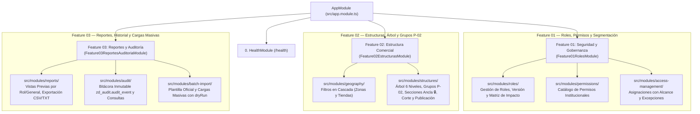

# Mapa Maestro de Features y Módulos — ZDeptos API (Liverpool)

Este documento es la **Guía Definitiva de Arquitectura y Trazabilidad** para desarrolladores, líderes técnicos y arquitectos de software de Servicios Liverpool. Explica la correspondencia exacta entre las **3 Features**, sus **8 módulos funcionales**, los **Casos de Uso (CU)** y las **69 Historias de Usuario (HU)** del sistema.

---

## 1. Diagrama de Organización Arquitectónica



---

## 2. Matriz Exhaustiva de Trazabilidad: Feature vs Módulo vs Historias

| Vertical / Feature | Carpeta en `src/modules/` | Módulo NestJS | Casos de Uso (CU) | Historias de Usuario (HU) | Dominios del Excel de Negocio | Endpoints Principales |
| :--- | :--- | :--- | :--- | :--- | :--- | :--- |
| **Feature 01: Seguridad y Gobernanza** | `roles/` | `RolesModule` | `CU-ROL-001` a `CU-ROL-005` | `HU-54` a `HU-57`<br>(HU-007..012) | **Dominio 9:** Seguridad y Roles | `GET/POST /api/v1/roles`<br>`GET/PUT/DELETE /api/v1/roles/:id`<br>`GET /api/v1/roles/:id/impact`<br>`POST /api/v1/roles/:id/clone` |
| **Feature 01: Seguridad y Gobernanza** | `permissions/` | `PermissionsModule` | `CU-ROL-001` | `HU-54`<br>(HU-007) | **Dominio 9:** Catálogo Institucional | Entidad central `permission` |
| **Feature 01: Seguridad y Gobernanza** | `access-management/` | `AccessManagementModule` | `CU-SEG-001`<br>`CU-EXC-001` | `HU-58` a `HU-61`<br>(HU-013..018) | **Dominio 9:** Tramo de Control | `GET /api/v1/users`<br>`GET/POST/PUT /api/v1/users/:id/role-assignments`<br>`POST /users/:id/role-assignments/:id/revoke`<br>`GET/POST /users/:id/permission-exceptions`<br>`GET /users/:id/effective-permissions` |
| **Feature 02: Estructura Comercial** | `geography/` | `GeographyModule` | `UC-004` | `HU-13`<br>(HU-019..021) | **Dominio 3:** Geografía Comercial | `GET /api/v1/geography/zones`<br>`GET /api/v1/geography/zones/:id/locations`<br>`GET /api/v1/geography/locations/:id` |
| **Feature 02: Estructura Comercial** | `structures/` | `StructuresModule` | `CU-EST-001`<br>`CU-ADM-001` a `CU-ADM-008`<br>`UC-006` a `UC-009` | `HU-14` a `HU-53`<br>(HU-022..054) | **Dominios 4 al 8:** Árbol, Grupos, Secciones, Mancuernas y Calendario | `GET /api/v1/structures/tree`<br>`GET /structures/locations/:id/summary`<br>`GET /structures/departments/:id/available-sections`<br>`POST/PUT/DELETE /structures/departments/:id/groups`<br>`POST/DELETE /structures/groups/:id/sections`<br>`PATCH /structures/departments/:id/sections/move`<br>`GET /structures/calendar/operational-cutoff`<br>`POST /structures/departments/:id/publish` |
| **Feature 03: Reportes y Auditoría** | `reports/` | `ReportsModule` | `CU-EST-002`<br>`CU-EST-003` | `HU-62` a `HU-67`<br>(HU-055..063) | **Dominio 10:** Reporteo y Exportación | `GET /api/v1/reports/metadata/columns`<br>`GET /api/v1/reports/role-based`<br>`GET /api/v1/reports/general`<br>`GET /api/v1/reports/compensations`<br>`GET /api/v1/reports/export/csv`<br>`GET /api/v1/reports/export/txt` |
| **Feature 03: Reportes y Auditoría** | `audit/` | `AuditModule` | `CU-HIS-001`<br>(ERF §7) | `HU-68`<br>(HU-064..066) | **Dominio 10:** Bitácora e Historial | `GET /api/v1/audit/logs`<br>`GET /api/v1/audit/logs/:eventId`<br>`GET /api/v1/audit/actions`<br>`GET /api/v1/audit/modules` |
| **Feature 03: Reportes y Auditoría** | `batch-import/` | `BatchImportModule` | `CU-CIN-001` | `HU-69`<br>(HU-067..069) | **Dominio 10:** Cargas Iniciales Masivas | `GET /api/v1/admin/batch-import/layout`<br>`POST /api/v1/admin/batch-import` (con `dryRun: true/false`) |

---

## 3. Estructura de Directorios del Código Fuente (`src/`)

```text
src/
├── app.module.ts                                       <-- Orquestador raíz que importa los 3 módulos de Feature
├── main.ts                                             <-- Configuración de Swagger y arranque en puerto 3000
│
├── common/                                             <-- Decoradores, guards y utilidades transversales
│   └── auth/
│       └── public.decorator.ts
│
├── health/                                             <-- Feature 0: Monitoreo de disponibilidad
│   ├── health.controller.ts
│   └── health.module.ts
│
├── shared/                                             <-- Componentes compartidos del sistema
│   ├── http/
│   │   └── authenticated-request.ts                    <-- Interfaz Request con usuario tipado
│   └── security/
│       └── security.ts                                 <-- ApiKeyGuard, PermissionsGuard, RequirePermissions
│
└── modules/                                            <-- Módulos de Dominio del Negocio
    │
    ├── feature-01-roles/                               <-- Módulo Orquestador Feature 01
    │   └── feature-01-roles.module.ts
    ├── roles/                                          <-- Feature 01: Gestión de Roles y Concurrencia
    │   ├── README.md
    │   ├── roles.module.ts
    │   ├── application/
    │   ├── domain/
    │   ├── presentation/
    │   └── tests/
    ├── permissions/                                    <-- Feature 01: Catálogo Institucional de Permisos
    │   ├── README.md
    │   ├── permissions.module.ts
    │   └── domain/
    ├── access-management/                              <-- Feature 01: Alcance Operativo y Excepciones
    │   ├── README.md
    │   ├── access-management.module.ts
    │   ├── access-management.controller.ts
    │   └── access-management.service.ts
    │
    ├── feature-02-estructuras/                          <-- Módulo Orquestador Feature 02
    │   └── feature-02-estructuras.module.ts
    ├── geography/                                      <-- Feature 02: Geografía y Selectores en Cascada
    │   ├── README.md
    │   ├── geography.module.ts
    │   ├── geography.controller.ts
    │   ├── geography.service.ts
    │   └── dto/
    ├── structures/                                     <-- Feature 02: Árbol 6 Niveles, Grupos y Secciones
    │   ├── README.md
    │   ├── structures.module.ts
    │   ├── application/
    │   ├── domain/
    │   ├── presentation/
    │   └── tests/
    │
    ├── feature-03-reportes-auditoria/                  <-- Módulo Orquestador Feature 03
    │   └── feature-03-reportes-auditoria.module.ts
    ├── reports/                                        <-- Feature 03: Reportes Dinámicos y Exportación CSV/TXT
    │   ├── README.md
    │   ├── reports.module.ts
    │   ├── application/
    │   ├── presentation/
    │   └── tests/
    ├── audit/                                          <-- Feature 03: Bitácora Inmutable y Consultas
    │   ├── README.md
    │   ├── audit.module.ts
    │   ├── application/
    │   ├── domain/
    │   ├── infrastructure/
    │   └── presentation/
    └── batch-import/                                   <-- Feature 03: Cargas Masivas Iniciales y Layout
        ├── README.md
        ├── batch-import.module.ts
        ├── application/
        ├── presentation/
        └── tests/
```

---

## 4. Visualización en Swagger UI

Al ingresar a **[http://localhost:3000/docs](http://localhost:3000/docs)**, la documentación interactiva OpenAPI agrupa todos los endpoints con etiquetas explícitas por Feature:

1. `0. Sistema y Monitoreo (Health Check)`
2. `Feature 01: Gestión de Roles y Permisos (HU-54 a HU-61)`
3. `Feature 01: Asignaciones de Roles y Alcance Operativo (HU-58 a HU-61)`
4. `Feature 02: Geografía Comercial y Filtros en Cascada (UC-004 / HU-13)`
5. `Feature 02: Estructura Comercial, Árbol y Grupos P-02 (CU-EST-001, CU-ADM-001..008 / HU-14..53)`
6. `Feature 03: Reportes Dinámicos y Exportación CSV / TXT (CU-EST-002, CU-EST-003 / HU-62..67)`
7. `Feature 03: Historial y Bitácora de Auditoría (CU-HIS-001 / HU-68)`
8. `Feature 03: Cargas Masivas Iniciales y Layout (CU-CIN-001 / HU-69)`
